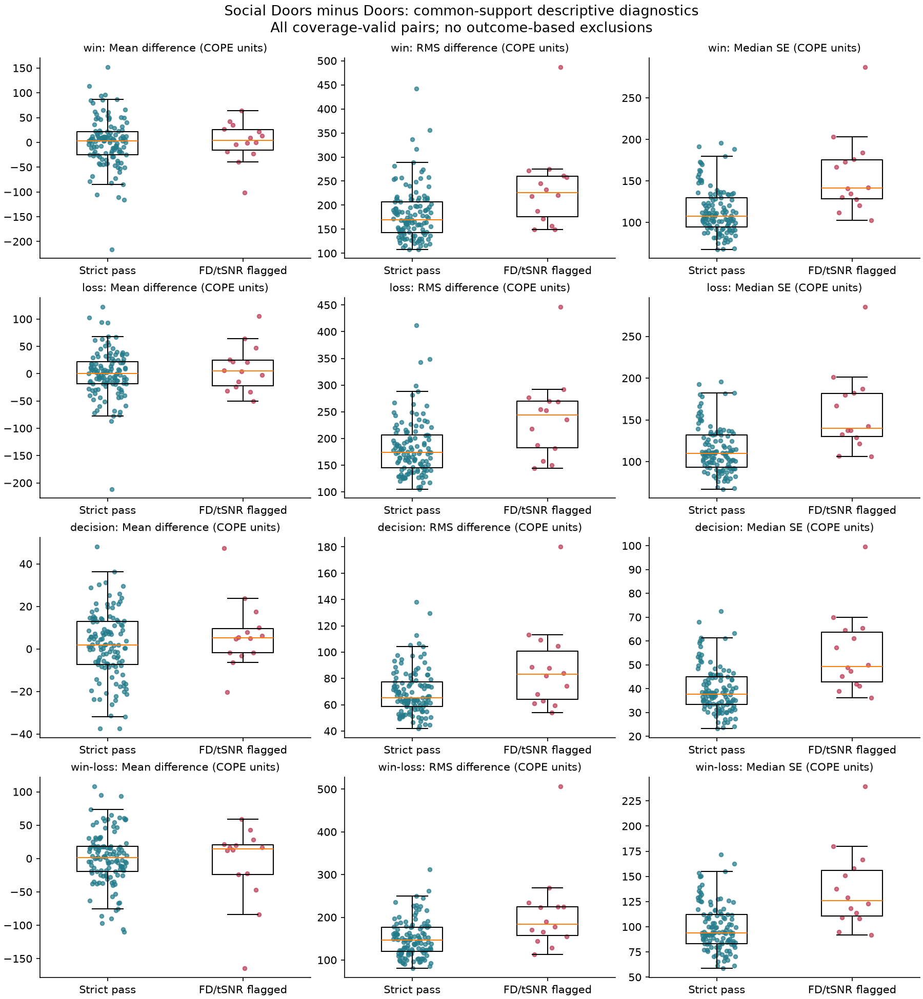
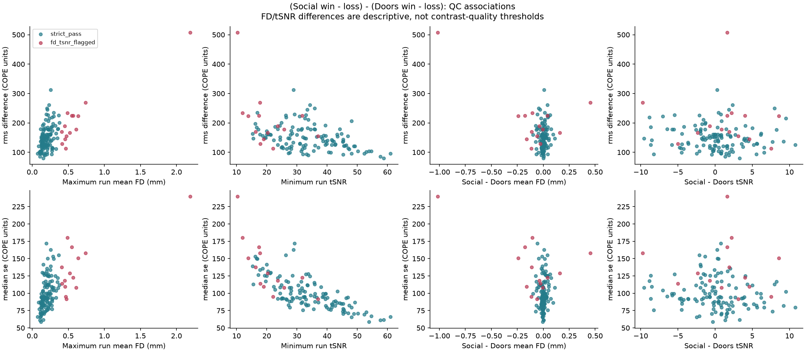

# Paired Social Doors Diagnostic Review

Reviewed October 27, 2026. The Linux2 diagnostic build and check both exited 0:
[validation record](../../../logs/records/20261027-145845_socialdoors-paired-diagnostic-20261027-145845.md).
The diagnostic verified 270 L1 runs and 540 paired contrasts, preserving source
decisions, >=95% per-run coverage, and existing no-TEDANA products.

## Recommendation and Counts

Retain the previously specified run-level FD/tSNR policy for the primary analysis.
Do not replace it with exclusions based on the observed difference effect.
The diagnostic does not prove every flagged participant unusable, but it does
not establish that subtraction removes the quality concern either.

| Imaging pool | Unique participants | Paired contrast rows |
| --- | ---: | ---: |
| Source-valid, coverage-passing pairs | 135 | 540 |
| Both tasks also pass FD/tSNR | 121 | 484 |
| Additional FD-flagged pairs | 14 | 56 |

All 14 additional pairs have high FD in at least one task: eight in Social Doors,
twelve in Doors, with six overlapping. None fails the low-tSNR fence. These are
age-55+, ses-01 imaging pools, not final survey-linked paper Ns.

The established thresholds are computed once within task/session over the full
canonical QC population, not fitted to these effects or the paper sample:

| Task | Exclude when mean FD is above | Exclude when tSNR is below |
| --- | ---: | ---: |
| Social Doors, ses-01 | 0.3880901658186131 mm | 5.894607224268839 |
| Doors, ses-01 | 0.3792709928410776 mm | 7.749883948621573 |

Both runs must also pass >=95% canonical coverage and the settled source-validity
decisions. No TEDANA-component-count or difference-effect exclusion is added.
This is pair eligibility for this contrast, not a blanket participant exclusion
from other tasks or sessions. Sophia's UGR selection remains unchanged at 137
imaging participants.

## What the Diagnostic Shows

For contrast 4, `(Social win - loss) - (Doors win - loss)`:

- Median of participant-level median SE: 125.90 in the FD-flagged group versus
  93.98 in strict-pass pairs, about 34% higher.
- Median RMS difference: 183.46 versus 147.12, about 25% higher. This measures
  effect magnitude, not artifact by itself, and is not an exclusion criterion.
- Median SE remains about 31% higher after omitting the single highest-FD case
  from this descriptive comparison. The pattern is not solely that case.
- Across all 135 pairs, Spearman rho between maximum run FD and median SE is
  0.599. Between minimum run tSNR and median SE it is -0.779.
- Between-task FD and tSNR differences are much less associated with median SE
  (rho 0.033 and -0.145, respectively). Similar quality in the two runs is not
  evidence of good quality in either run.

The groups overlap. Some flagged pairs have uncertainty within the strict-pass
range; some passing pairs have high uncertainty. These descriptive associations
do not establish causality, individual invalidity, or a uniquely optimal cutoff.
They provide no basis to cherry-pick participants using favorable contrasts.

All summaries use the same 79,801-voxel common support, 63.66% of the union of
pair masks. That fraction is **not** per-run canonical coverage; all included
runs pass the original coverage requirement. Peripheral artifacts outside the
common support are not assessed by these summary plots. SE assumes independent
run estimation errors, as documented in the diagnostic. There are no new
significance tests or L3 fits here.





## Exact Files for Jacob

After updating the Linux2 checkout through Git:

```text
/ZPOOL/data/projects/rf1-sra-linux2/qc/paired_difference/socialdoors-v1/strict_pairs.tsv
/ZPOOL/data/projects/rf1-sra-linux2/qc/paired_difference/socialdoors-v1/subjects_strict.txt
```

`strict_pairs.tsv` contains the 121-pair intersection with four matched contrasts
per participant and the original Social Doors/Doors COPE, VARCOPE, mask and DOF
paths. It is exactly `diagnostic_pairs.tsv` filtered to `group == strict_pass`,
independently cross-checked against the numerical FD/tSNR fences and preserved
run decisions. It does not require another imaging run or another pairing job.

For an explicitly labeled broader sensitivity analysis, `diagnostic_pairs.tsv`
contains all 135 pairs. It is not a replacement primary cohort by default.
Do not treat its existing diagnostic difference maps as a silently promoted
production FEAT/L3 pipeline. Use the established within-participant difference
procedure and preserve uncertainty propagation. The old cross-task L2 **mean**
is not Social Doors minus Doors.

Intersect the 121-pair primary pool with Katie's approved survey/linkage roster
before its previous imaging-QC exclusions. Select the intended contrast, align
all input/design/covariate rows, and report the resulting unique-participant N.
Do not reapply older aggregate/TEDANA flags or exclude large difference effects.

## Provenance and Transfer

The four original TSVs and two PNGs are byte-identical copies of the supplied
`socialdoors-paired-diagnostic-v1` report. Cross-checks reproduced all participant
counts, four-contrast completeness, task/session pairing, numerical QC labels,
coverage requirements, and preserved run decisions. Derived strict rows retain
the original order and values. The local review did not rerun server-side image
arithmetic; that was checked by the published Linux2 job above.

Reports, tables and plots are transferred through Git. Production NIfTI data,
preprocessing outputs, original diagnostic artifacts and settled decisions were
not modified. No additional scp/rsync step is part of this handoff.
