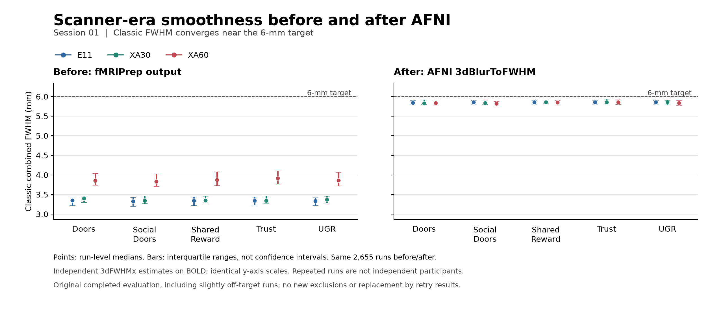
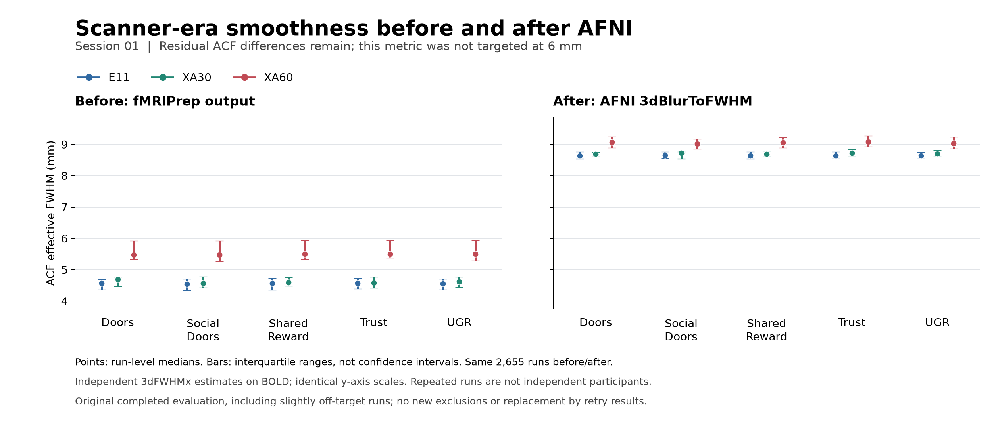
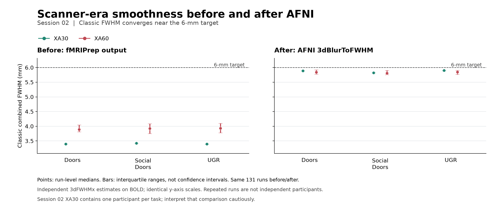
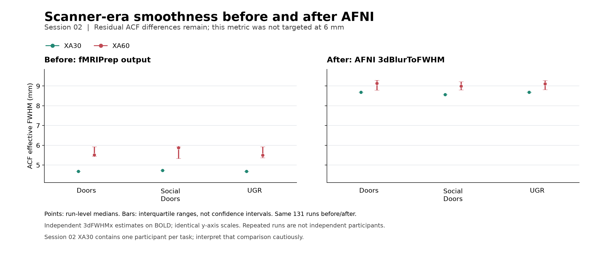

# Scanner-era smoothness: before and after AFNI

Report-only replot of the completed isolated 6-mm evaluation. No image processing,
eligibility decisions, or analysis inputs changed. Figures use the published run-level
medians and interquartile ranges, not reconstructed raw distributions or confidence intervals.

Baseline is unsmoothed non-echo fMRIPrep MNI BOLD, **not raw BIDS/MRIQC**.
After is the original AFNI `3dBlurToFWHM` 6-mm-target output, independently measured
with the frozen Shared Reward `3dFWHMx -ShowMeClassicFWHM -detrend -mask ... -acf NULL` method.
Classic combined FWHM and ACF effective FWHM are different measures. Only classic FWHM
was targeted; these are BOLD smoothness estimates, not task-model residual estimates.

All 2,786 paired runs are represented, including the 5 original
outside-band outputs. No successful-only filtering or substitution of 10657 `-bmall`
retry values. That retry changed the five estimates little and is a separate experiment.
The validation separately records 13 source-excluded entries without paired estimates.
Existing source/task exclusions remain binding; measurement inclusion does not grant analysis eligibility.

## Figures









## Scanner-era separation

Range = largest minus smallest scanner-era median **within the same task/session**.
Reduction describes this median separation, not variance explained, statistical significance,
or proof that scanner software caused the difference. Do not pool tasks or sessions.

| Session | Task | Metric | Before range (mm) | After range (mm) | Reduction |
|---|---|---|---:|---:|---:|
| 01 | Doors | acf | 0.9163 | 0.4251 | 53.6% |
| 01 | Doors | classic | 0.5022 | 0.0163 | 96.8% |
| 01 | Shared Reward | acf | 0.9388 | 0.4166 | 55.6% |
| 01 | Shared Reward | classic | 0.5294 | 0.0126 | 97.6% |
| 01 | Social Doors | acf | 0.9263 | 0.3639 | 60.7% |
| 01 | Social Doors | classic | 0.5071 | 0.0314 | 93.8% |
| 01 | Trust | acf | 0.9369 | 0.4421 | 52.8% |
| 01 | Trust | classic | 0.5731 | 0.0043 | 99.2% |
| 01 | UGR | acf | 0.9390 | 0.3924 | 58.2% |
| 01 | UGR | classic | 0.5247 | 0.0280 | 94.7% |
| 02 | Doors | acf | 0.8328 | 0.4571 | 45.1% |
| 02 | Doors | classic | 0.4948 | 0.0426 | 91.4% |
| 02 | Social Doors | acf | 1.1478 | 0.4269 | 62.8% |
| 02 | Social Doors | classic | 0.5034 | 0.0185 | 96.3% |
| 02 | UGR | acf | 0.8234 | 0.4278 | 48.0% |
| 02 | UGR | classic | 0.5374 | 0.0538 | 90.0% |

## Sample sizes

Counts are runs / participants within each cell; do not sum subjects across tasks.
Session 02 has only one XA30 participant per task (two UGR runs).

| Session | Task | Era | Paired runs | Participants | Outside original band |
|---|---|---|---:|---:|---:|
| 01 | Doors | E11 | 197 | 197 | 1 |
| 01 | Doors | XA30 | 17 | 17 | 0 |
| 01 | Doors | XA60 | 124 | 124 | 0 |
| 02 | Doors | XA30 | 1 | 1 | 0 |
| 02 | Doors | XA60 | 32 | 32 | 0 |
| 01 | Shared Reward | E11 | 395 | 208 | 1 |
| 01 | Shared Reward | XA30 | 34 | 17 | 0 |
| 01 | Shared Reward | XA60 | 239 | 123 | 0 |
| 01 | Social Doors | E11 | 196 | 196 | 1 |
| 01 | Social Doors | XA30 | 17 | 17 | 0 |
| 01 | Social Doors | XA60 | 124 | 124 | 0 |
| 02 | Social Doors | XA30 | 1 | 1 | 0 |
| 02 | Social Doors | XA60 | 32 | 32 | 0 |
| 01 | Trust | E11 | 380 | 204 | 2 |
| 01 | Trust | XA30 | 34 | 17 | 0 |
| 01 | Trust | XA60 | 238 | 123 | 0 |
| 01 | UGR | E11 | 388 | 205 | 0 |
| 01 | UGR | XA30 | 34 | 17 | 0 |
| 01 | UGR | XA60 | 238 | 121 | 0 |
| 02 | UGR | XA30 | 2 | 1 | 0 |
| 02 | UGR | XA60 | 63 | 32 | 0 |

## Reproduce

From the repository root:

```bash
umask 0000
python3 code/plot_smoothness_era_overview.py
```

Requires matplotlib. Reads only the tracked summary and validation JSON; no Linux2 imaging access is needed.
Sources: [paired summary](../paired_summary.tsv), [validation](../validation.json),
[measurement method](../../../docs/cohort-afni-smoothness.md).
